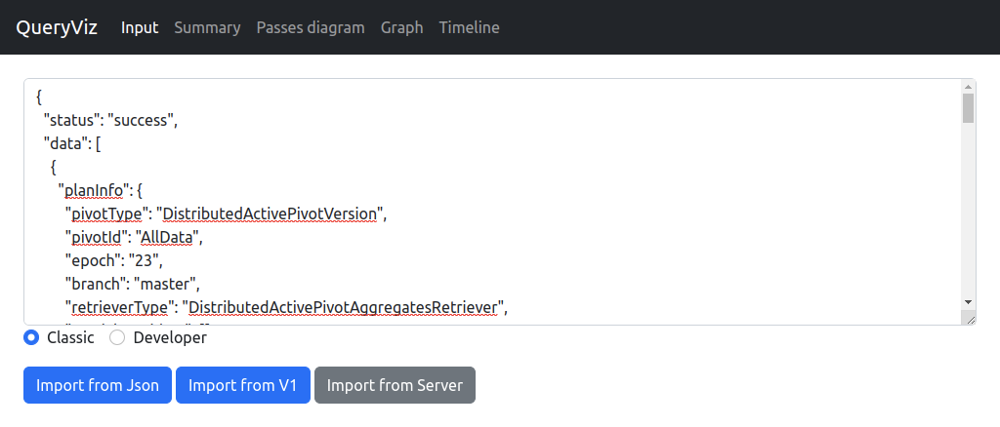
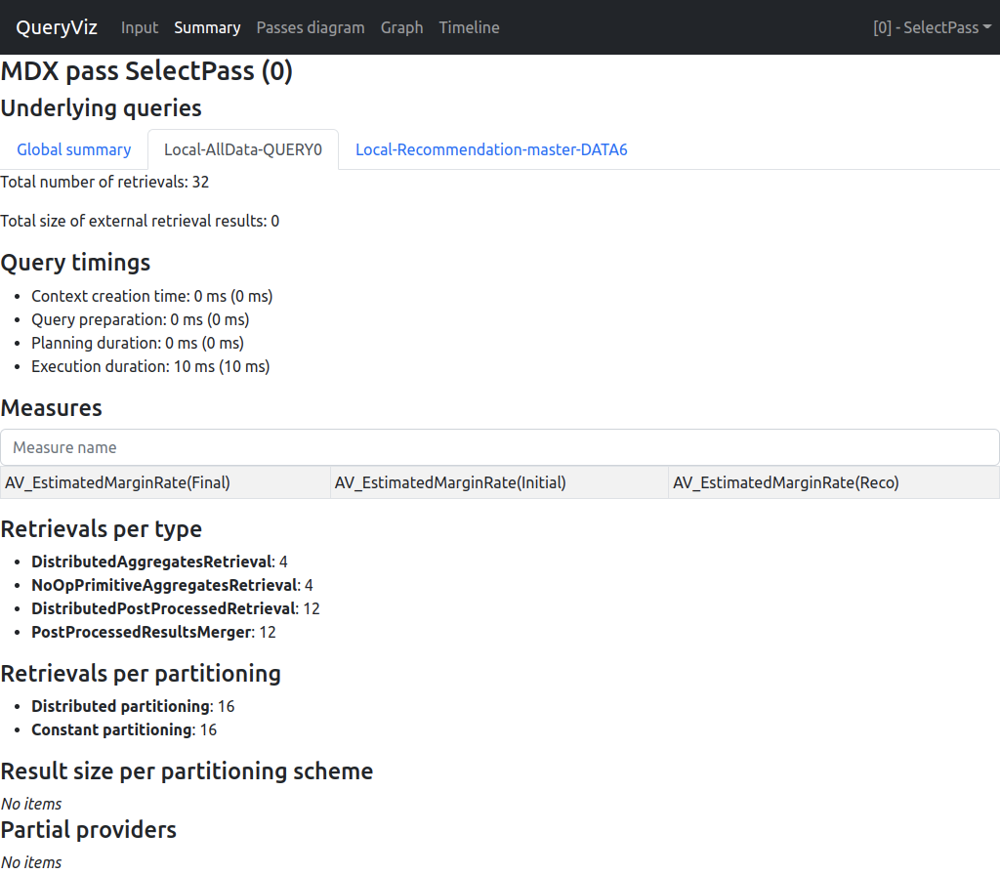
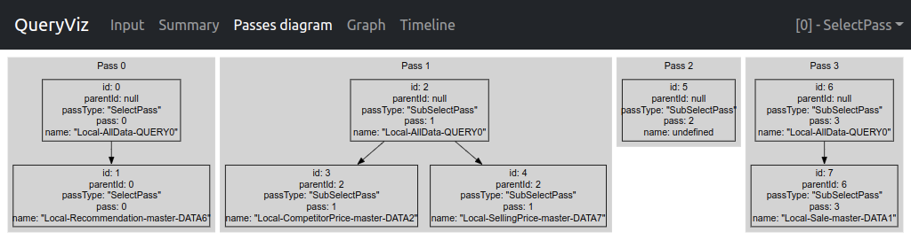
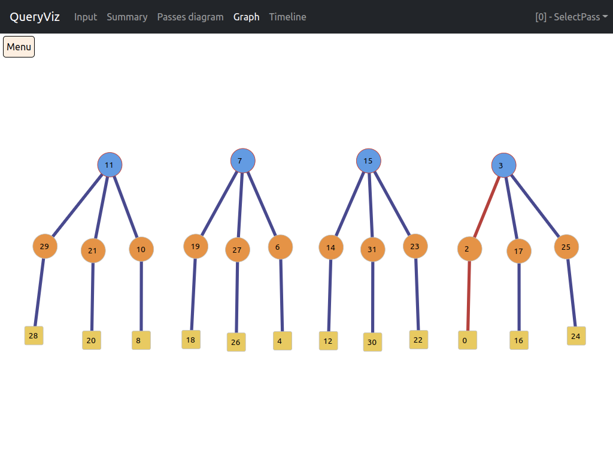
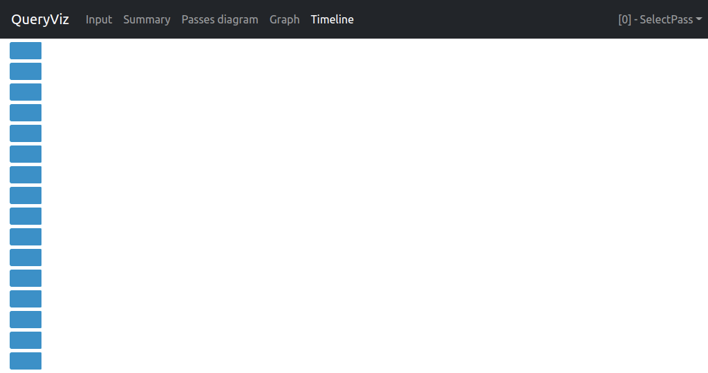
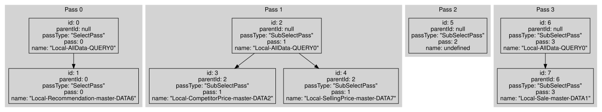

# Atoti Query Analyzer

## Application Overview

This application is used to analyze query execution plan reports. It can consume data in format of ActivePivot logs (referred to as V1) and in form of JSON.

Application has 5 sections: **Input**, **Summary**, **Passes diagram**, **Graph**, **Timeline**.

**Input** is used for consuming plan reports:

**Summary** shows statistics on queries (e.g. execution time, measures, count of retrievals by type etc.):

**Passes diagram** shows info about passes and dependencies between queries.

**Graph** shows retrievals executed within a query, as well as dependencies between them:

**Timeline** represents execution time of retrievals:

## Data model

Input data is organized in form of list of _query plans_. Inside the query analyzer, query plans are represented by
interface `QueryPlan`, which corresponds to the class `com.quartetfs.biz.pivot.query.aggregates.IQueryPlan` in
ActivePivot.

Queries may be executed within one or several _passes_. Each query belongs to one pass. Each pass has one _root query_,
which optionally depends on other queries from this pass. In their turn, these queries may also have dependencies,
and so on. Dependencies can ber represented as a tree diagram:

List of processed query plans is stored in `queryPlans` state variable of the `App` component.
Relations between queries (tree structure and pass info) are stored in `queryMetadata` state variable.

Each query has a set of retrievals. Some of them depend on others. Graph of retrievals is stored as a `RetrievalGraph`.

## Project structure

- `e2e`: end-to-end tests (Playwright) and their fixtures
- `media`: assets for documentation
- `public`: static assets of the web application
- `src`: source code
  - `components`: React components
    - `Details`: component for showing retrieval info
    - `ErrorBoundary`: technical component for catching react rendering-time errors
    - `Graph`: component for graph drawing
    - `Input`: component for input consuming
    - `NavBar`: component for navigation panel
    - `Notification`: technical component for showing notifications
    - `PassGraph`: component for showing info on passes and query dependencies
    - `Summary`: component for showing query summary
    - `Timeline`: component for showing timeline
  - `hooks`: react hooks (mechanism for indirect communication between components and arbitrary js code)
  - `library`: React-free part of code
    - `dataStructures`: data structures used in this project
      - `common`: reusable containers and algorithms
      - `d3`: interfaces for communication with d3.js
      - `json`: interfaces and functions for parsing and validating raw json
      - `processing`: interfaces and functions for building handy internal data representation
    - `devTools`: utilities for making debugging easier
    - `graphProcessors`: tools for processing query plans
    - `graphView`: tools for graph visualization
    - `inputProcessors`: tools for input parsing and processing
    - `utilities`: helper functions

## Project configuration

### Lint and format

The project uses [oxlint](https://oxc.rs/docs/guide/usage/linter) and [oxfmt](https://oxc.rs/docs/guide/usage/formatter) with their default configuration (`.oxlintrc.json` and `.oxfmtrc.json`).

### TypeScript project configuration

This config is mostly autogenerated...

### Available Scripts

The project uses [pnpm](https://pnpm.io/). Its version is set by the `packageManager` field of `package.json`: with [Corepack](https://nodejs.org/api/corepack.html) enabled, `pnpm` picks it automatically.

Install the dependencies with `pnpm install`, then run, in the project directory:

#### `pnpm start`

Run the Vite development server, at [http://localhost:5173](http://localhost:5173).
The page reloads on every change.

#### `pnpm build`

Build the application for production, in the `build` folder.
Use `pnpm preview` to serve this build locally.

#### `pnpm test`

Run the unit tests (Vitest) in watch mode.
Use `pnpm test:run` to run them once, and `pnpm test:coverage` to also collect the coverage, written to `coverage/`, and check its thresholds.

#### `pnpm e2e`

Run the end-to-end tests with Playwright. The dev server is started automatically.
Use `pnpm e2e:ui` to open the Playwright UI mode.

#### `pnpm lint`

Run oxlint to find code quality issues. Use `pnpm lint:fix` to apply the automatic fixes.

#### `pnpm format`

Format the code with oxfmt. Use `pnpm format:check` to only check it.

#### `pnpm typecheck`

Type-check the code with `tsc`.
